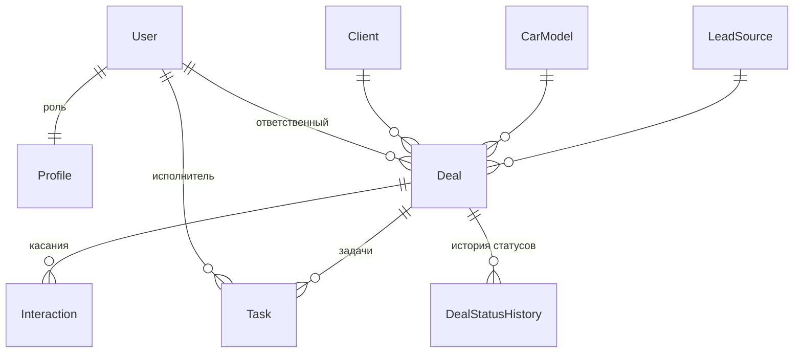
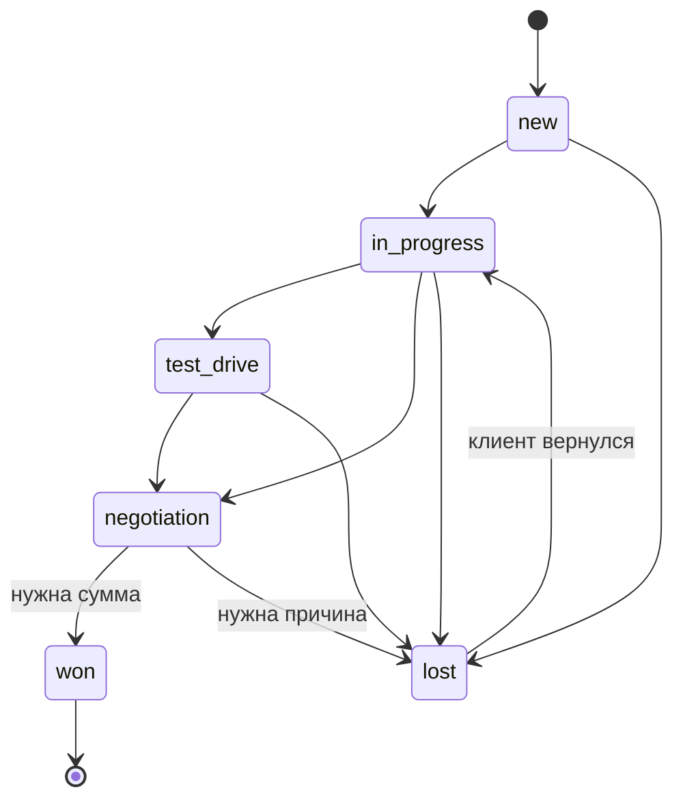

# CRM дилерского центра

Дипломный проект: CRM-система для отдела продаж автомобильного дилерского центра Kia.
Учитывает клиентов и сделки, ведёт сделку по воронке продаж по строгим правилам,
хранит историю касаний и смены статусов, ставит задачи менеджерам и считает
конверсию по источникам лидов, менеджерам и моделям автомобилей.

**Стек:** Python 3.13, Django 5.1, Django REST Framework, JWT (SimpleJWT), PostgreSQL 16,
django-filter, drf-spectacular (Swagger/OpenAPI), Docker Compose.

## Возможности

- Регистрация и вход: JWT для API, сессии для веб-интерфейса.
- Три роли с разными правами: администратор, руководитель отдела продаж, менеджер.
- CRUD клиентов, сделок, задач, справочников моделей авто и источников лидов.
- Воронка продаж с контролем переходов: сделку нельзя перевести из «Новый лид» сразу в «Продан»;
  для «Продан» обязательна сумма, для «Отказ» - причина. Каждый переход пишется в историю.
- Назначение ответственного менеджера руководителем.
- Журнал касаний с клиентом: звонки, встречи, тест-драйвы, сообщения.
- Задачи менеджеров: «на сегодня», «просроченные», отметка о выполнении.
- Аналитика: распределение по этапам, конверсия, выручка, средний чек;
  разбивка по источникам, менеджерам и моделям; фильтр по периоду.
- Поиск, фильтрация, сортировка и пагинация во всех списках API.
- Веб-интерфейс на Django templates, Django Admin, Swagger-документация.

## Роли и права

| Действие | Менеджер | Руководитель | Администратор |
|---|---|---|---|
| Видеть сделки | только свои | все | все |
| Создавать сделки и клиентов | да (сделка закрепляется за ним) | да | да |
| Менять статус сделки | свои | все | все |
| Назначать менеджера на сделку | нет | да | да |
| Изменять справочники (модели, источники) | нет | да | да |
| Аналитика | по своим сделкам | по всему центру | по всему центру |
| Удалять сделки и клиентов | нет | нет | да |
| Управлять пользователями и ролями | нет | только просмотр | да |

## Модель данных



| Модель | Назначение |
|---|---|
| `Profile` | роль и телефон пользователя (расширение стандартного `User`) |
| `CarModel` | модели автомобилей в продаже: марка, модель, кузов, цена |
| `LeadSource` | источники лидов: Paid Search, Paid Socials, Instagram/Facebook, сайт, реферальные ссылки |
| `Client` | клиент: ФИО, телефон (уникальный, формат +7XXXXXXXXXX), email, город |
| `Deal` | сделка: клиент, модель, источник, менеджер, статус, сумма |
| `DealStatusHistory` | журнал переходов статусов: откуда, куда, кто, когда |
| `Interaction` | касания с клиентом |
| `Task` | задачи менеджеров со сроком |

### Воронка продаж



Правила переходов описаны в `Deal.TRANSITIONS` (`crm/models.py`), проверка - в
`services.change_deal_status` (`crm/services.py`). Изменить статус через обычный PATCH нельзя,
только через отдельный endpoint, поэтому обойти правила не получится.

## Запуск через Docker (рекомендуется)

Нужен только Docker Desktop. Из папки проекта:

```bash
docker compose up --build
```

При первом запуске автоматически применяются миграции и создаются демо-данные
(15 клиентов, 15 сделок, 5 менеджеров). Затем откройте:

- Веб-интерфейс: http://localhost:8000
- Swagger: http://localhost:8000/api/docs/
- Админка: http://localhost:8000/admin/

Остановить: `Ctrl+C`. Удалить вместе с базой: `docker compose down -v`.

## Запуск без Docker (SQLite)

```powershell
python -m venv .venv
.venv\Scripts\activate
pip install -r requirements.txt
python manage.py migrate
python manage.py seed_demo
python manage.py runserver
```

Без переменных окружения `POSTGRES_*` проект использует SQLite.

## Демо-пользователи

Пароль у всех: `Demo12345!`

| Логин | Роль |
|---|---|
| `admin` | Администратор (доступ в админку) |
| `head` | Руководитель отдела продаж |
| `manager1` ... `manager5` | Менеджеры |

Пересоздать демо-данные: `python manage.py seed_demo --reset`.

## REST API

Авторизация: `POST /api/auth/token/` с `username` и `password` возвращает `access` и `refresh`.
Дальше передавайте заголовок `Authorization: Bearer <access>`.
В Swagger нажмите **Authorize** и вставьте access-токен.

| Метод и путь | Описание |
|---|---|
| `POST /api/auth/register/` | регистрация (роль «Менеджер») |
| `POST /api/auth/token/`, `POST /api/auth/token/refresh/` | получение и обновление JWT |
| `GET/PATCH /api/auth/me/` | текущий пользователь |
| `/api/users/` | пользователи и роли (админ) |
| `/api/car-models/`, `/api/lead-sources/` | справочники |
| `/api/clients/` | клиенты; поиск `?search=`, фильтр `?city=` |
| `/api/deals/` | сделки; фильтры `status`, `source`, `car_model`, `manager`, `brand`, `created_from`, `created_to`, `amount_min`, `amount_max`; `?search=`, `?ordering=-amount` |
| `POST /api/deals/{id}/change_status/` | смена статуса: `{"status": "won", "amount": 15990000}` |
| `POST /api/deals/{id}/assign/` | назначение менеджера: `{"manager": 3}` |
| `GET /api/deals/{id}/history/` | история статусов |
| `/api/interactions/` | касания; фильтр `?deal=` |
| `/api/tasks/` | задачи |
| `GET /api/tasks/today/`, `GET /api/tasks/overdue/` | задачи на сегодня, просроченные |
| `POST /api/tasks/{id}/complete/` | отметить задачу выполненной |
| `GET /api/analytics/summary/?date_from=2026-09-01&date_to=2026-09-30` | аналитика |

## Структура проекта

```
config/            настройки, корневые URL
accounts/          профиль и роли, регистрация, JWT, пользователи
  roles.py         функции проверки роли (используются везде)
crm/
  models.py        модели и правила переходов воронки
  services.py      бизнес-логика: смена статуса, назначение, аналитика, видимость по ролям
  serializers.py   сериализаторы и валидация API
  api_views.py     ViewSet'ы REST API
  permissions.py   права доступа API
  filters.py       фильтры сделок и задач
  web_views.py     страницы веб-интерфейса
  management/commands/seed_demo.py   демо-данные
templates/, static/  шаблоны и стили
```

Бизнес-логика вынесена в `services.py`, поэтому REST API и веб-интерфейс используют
одни и те же правила.